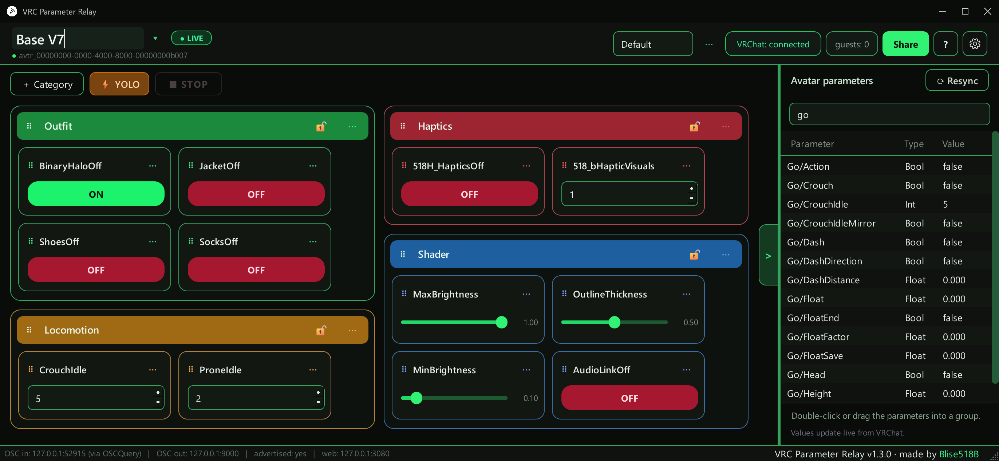

# VRC Parameter Relay

Control your VRChat avatar parameters from a desktop panel — and let friends
do it too, from any browser on phone or PC, through a share link. No port
forwarding, no accounts, no setup.

   
  🐧 Linux? The AppImage is on the
  <a href="https://github.com/Blise518B/VRCParameterRelay/releases/latest">Releases</a> page.

## What it does

- Shows every parameter of your current avatar live (via OSCQuery — it never
  touches port 9001, so it runs fine next to VRCFaceTracking & co.)
- Build boards from toggles, hold buttons, sliders and steppers — drag & drop
  into categories, saved per avatar, switches automatically with your avatar
- Lock a category so guests can look but not touch
- Invert a toggle (⇄) when a parameter's logic is backwards
- Number (Int) parameters work as toggles and hold buttons too — each one
  sets its own value (Outfit = 1, 2, 3 …) and they switch each other off,
  just like VRChat's own menu
- **Share**: your own fixed link — the same one every time, even after a
  restart. Anyone with it can use your board from any browser; it connects
  straight to your PC (peer-to-peer over [iroh](https://iroh.computer), end-to-end
  encrypted). Pause blocks guests but keeps the link; Reset link makes a new
  one and kicks everyone on the old one
- Prefer a tunnel? *Link settings* still has the Cloudflare quick tunnel and
  a free ngrok static domain. Or type your own domain into *Share → Your own
  address* (setup guide: [docs/REMOTE-ACCESS.md](docs/REMOTE-ACCESS.md))
- **⚡ YOLO mode**: guests get all parameters, not just your board

## Quick start

1. Hit the big **Download for Windows** button above — a single file,
   nothing to install
2. In VRChat: *Action Menu → Options → OSC → Enabled*
3. Start the app, open the parameter panel (green tab on the right edge),
   double-click a parameter to make a control
4. **Share → Start sharing** → send the link

First start takes a few seconds. Windows SmartScreen will complain about the
unsigned exe — *More info → Run anyway*.

## Good to know

- Settings and boards live in `%APPDATA%\VRCParameterRelay`
- The app has to run on the same PC as VRChat
- The fixed link works while the app is running and sharing; when it's
  closed, the page waits and connects by itself once you're back
- Cloudflare quick-tunnel links (Link settings) change when you restart the
  app; the fixed link doesn't
- On Linux, use the AppImage from Releases

## From source

    git clone https://github.com/Blise518B/VRCParameterRelay
    cd VRCParameterRelay
    start.bat        # sets up .venv and launches

Python 3.10+. `build.bat` builds the exe. `tools\fake_vrchat.py` +
`tools\integration_test.py` test the whole pipeline without VRChat; the other
`tools\*_test.py` scripts are safe to run while VRChat is open.

## License

[MIT](LICENSE)

Built with the help of AI.
